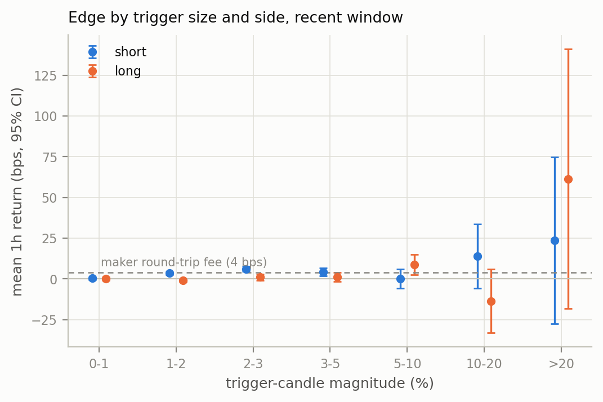
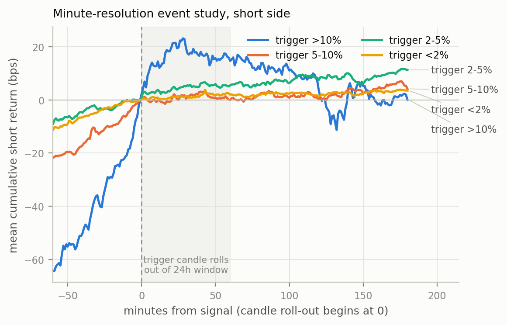
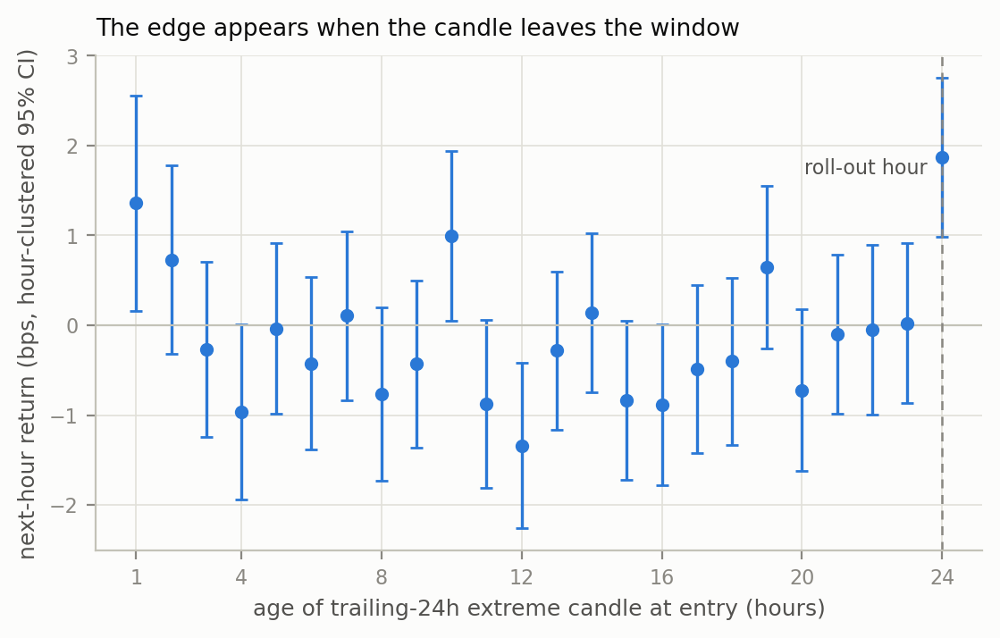
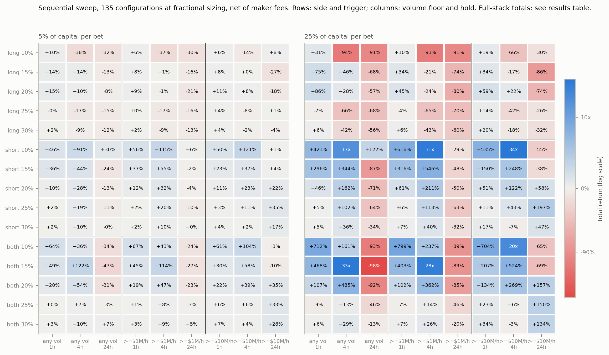
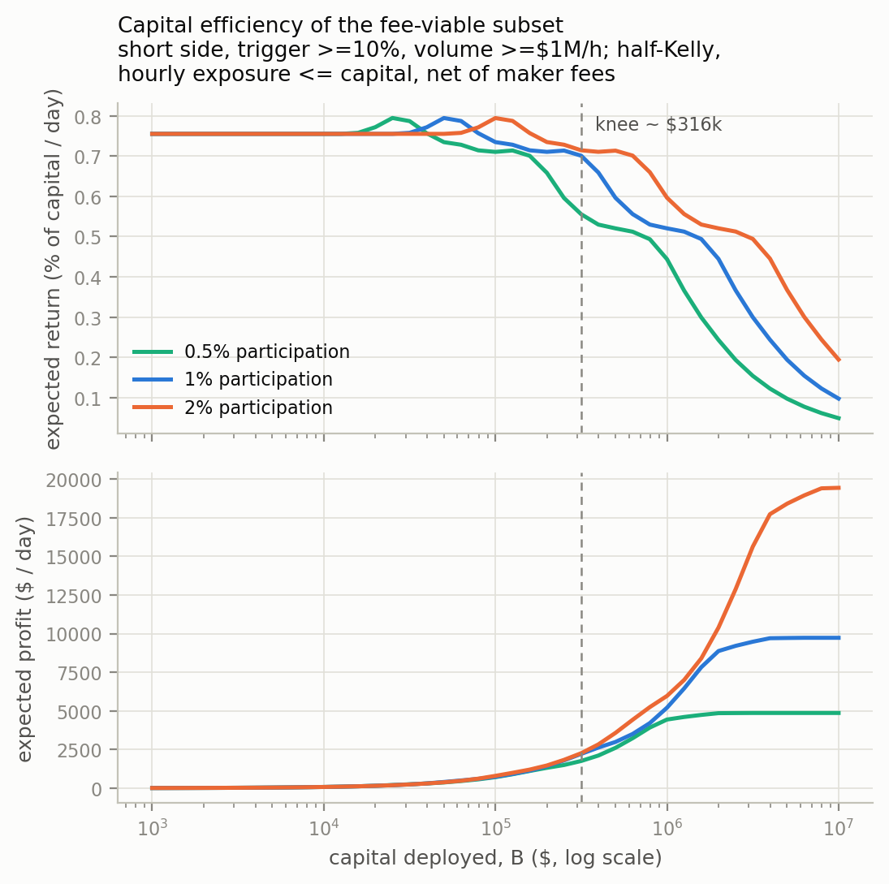
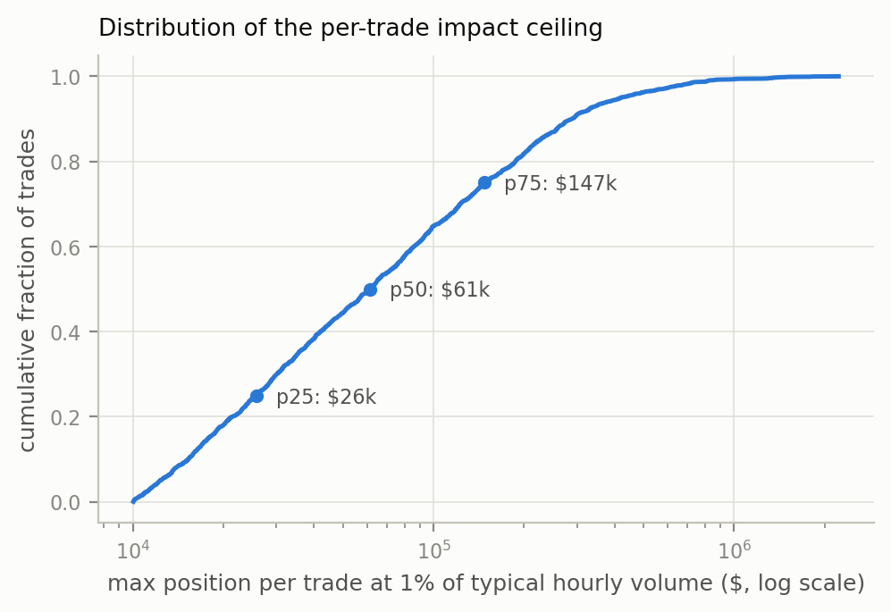
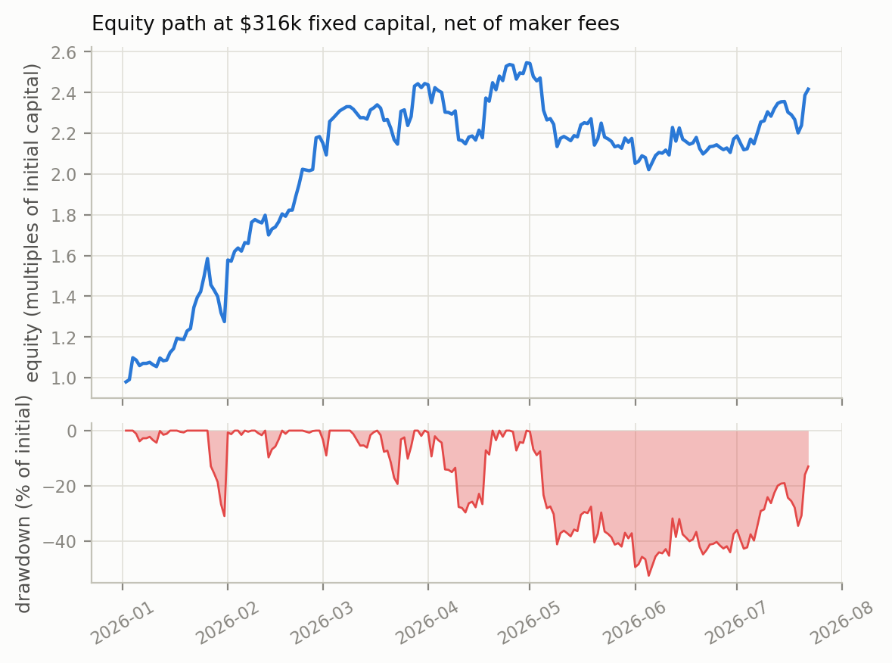
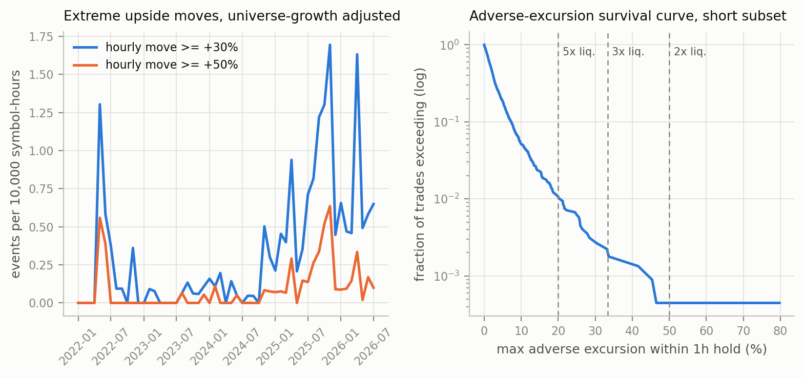

# The 24-Hour Roll-Out Effect in Binance Perpetual Futures

A pricing anomaly driven by a number on a screen: verification,
identification, and what is left after costs, capacity and tail risk.

---

## Summary

Every crypto exchange shows a rolling 24-hour price change next to each
asset. Half of that statistic is already known: when a large candle from
exactly 24 hours ago drops out of the window, the displayed number moves on
its own, whatever current price is doing. If enough order flow reacts to
the number instead of the price, returns become predictable around these
roll-out events. A [public thread](https://x.com/therobotjames/status/2080281157246259663)
put the gross edge of an hourly rule built on this at about 0.08% per
contract per day.

Tested on the complete Binance USDT-perpetual record (788 contracts
including every delisted one, 2020-2026), the claim holds: 0.070% to 0.086%
per contract-day over the trailing four years, positive every calendar
year. A placebo test across all 24 possible candle ages finds the edge only
in the roll-out hour, which pins the effect to the displayed statistic
about as tightly as price data can.

The tradeable residue is much thinner than the anomaly. Fees eliminate the
raw signal and funding subtracts more. Concentrated full-capital variants
post six-figure percentage backtests that dissolve into fee and
path-timing artifacts; the same trade sequences at sane bet sizes compound
to tens of percent to tens of x over four years, with no ruin anywhere on
the grid. Selection is fragile: the same training grid yields a losing
strategy or a stable +24 bps rule depending on the statistics used to pick
the winner. Capacity is a few hundred thousand dollars, shared among
everyone trading it, and the surviving subset drew down half its starting
capital inside its own 202-day showcase window.

## 1. Signal

Each hour, on completed candles, for every non-stablecoin USDT perpetual:

* short one hour when the candle exactly 24 hours ago was the largest
  positive candle of the trailing 24 (its exit mechanically depresses the
  displayed 24h change over the coming hour);
* long one hour when it was the largest negative candle.

Execution at the next candle open. All inputs are known at entry.

## 2. Data

| | |
|---|---|
| Universe | 788 USDT-quoted perpetuals: every contract with published archives at the snapshot date, delisted included, from both monthly and daily archive trees; stablecoin bases excluded |
| Hourly candles | 2020-01-01 to 2026-07-22, 14.46M |
| Minute candles | 2026-01-01 to 2026-07-22, 165.8M, 690 symbols |
| Source | data.binance.vision, snapshot 2026-07-23, frozen manifests in `manifests/`; monthly archives beat daily on overlap; microsecond timestamps normalized |

## 3. Baseline effect

The rule fires 1,165,160 times over the full sample, about twice per
contract-day, split almost evenly between sides.

| Period | Signals | Mean 1h return | Win rate |
|---|---|---|---|
| Full sample (2020-2026) | 1,165,160 | +4.75 bps | 49.9% |
| Trailing 4 years | 991,147 | +3.66 bps | 49.5% |

| Year | 2020 | 2021 | 2022 | 2023 | 2024 | 2025 | 2026 |
|---|---|---|---|---|---|---|---|
| Mean bps/trade | +8.2 | +10.7 | +10.1 | +3.5 | +3.9 | +4.2 | +2.1 |

Same-hour signals across contracts are strongly correlated, so per-trade
t-statistics mean little here; the hourly portfolio series gives t = 4.2
over the trailing four years, an annualized Sharpe near 2.1 before costs.
Per contract the signal earns 0.086% per active day (0.070% per listed
day), matching the source claim. It dies at realistic fees: -6.3 bps per
trade at a 10 bps taker round trip, -0.3 bps even at a 4 bps maker round
trip.

Two conditioning variables matter, both known at entry. The edge climbs
with trigger size, from +0.5 bps below 1% to +39 bps above 20%. And it
lives in the roll-out hour: +3.7 bps at a 1h hold, -7.3 bps at 24h. Since
2024 the short side carries nearly all of it.



## 4. Identification

Minute-level event study, all 247,469 signals of 2026, side-adjusted paths
from 60 minutes before entry to 180 after:



* Price is already drifting in the trade's direction before entry (about
  64 bps over the prior hour for large-trigger shorts). The pump fades
  before the statistic resets; the signal rides continuation, and nothing
  reverses at minute 0.
* After entry the drift builds roughly linearly across minutes 0-60, the
  same shape as the mechanical decay of the displayed number.
* For the largest triggers the flow is temporary: the short-side drift
  peaks near +20 bps around minute 30 and is fully given back within three
  hours.

The placebo test conditions on the trailing-24h extreme candle having age
k, for every k from 1 to 24, and measures the next-hour side-adjusted
return. Inference is clustered by hour, one observation per hour.



Ages 1 through 23 average -0.21 bps and scatter around zero with mixed
signs; a few graze conventional significance, about what 23 tests produce
by chance. Age 24 stands apart at +1.87 bps with clustered t = 4.2, the
only age that survives correcting for 24 comparisons. The edge belongs to
the hour the candle leaves the display window, and to nothing else.

## 5. Concentrated full-capital variants

A sweep of 135 configurations (trigger 10-30%, liquidity floors, 1/4/24h
holds, long/short/both; one non-overlapping position at a time on full
capital; maker fees; losses floored at -100%; deterministic tie-breaks;
entry-time filters only) spans ruin to a four-figure equity multiple, with
15 cells above +900%.

Those full-stack totals live in the results table
(`results/reconstruction.txt`), where two gradients look paradoxical next
to section 3 and are worth decomposing. Per-trade edge rises with trigger
size, yet totals fall as the threshold climbs; and 24h holds average
positive per-trade returns on big triggers, yet every full-stack 24h cell
ruins. Both follow from full-capital compounding, whose log growth equals
the arithmetic edge minus half the per-trade variance. The short/25%/1h
cell takes trades averaging +5.4 bps, but their 5.1% volatility costs 13.2
bps of drag, so the path compounds at -8.3 bps per trade to -51%. At 24h
holds the taken trades average +59 bps against roughly 100 bps of drag
from 14% per-trade volatility, plus occasional outright -100% trades, so
ruin is arithmetic certainty rather than bad luck.

Full-stack betting is what the source claim specifies, but nearly
everything dramatic about it, in both directions, is a property of the
sizing rule rather than the signal. The heatmap therefore shows the same
135 trade sequences at sane sizes, 5% and 25% of capital per bet:



Drag scales with the square of the sizing fraction, so at these sizes no
cell ruins and the ruin-luck problem disappears. At 5% per bet the map is
nearly a pure image of the per-trade edge table: the short block is almost
uniformly positive (up to +121%), the long block is flat to negative, and
nothing is dramatic. At 25% per bet the best cells (short side, 10%
triggers, 1-4h holds) compound to 17x-34x while bad corners reach -98%.
The honest range of this strategy family under defensible sizing is
therefore tens of percent to tens of x over four years, concentrated in
short-side moderate triggers.

The sweep's maximum is a path-timing artifact. Its eligible set contains
one short that returns -269%, a contract that kept squeezing after entry.
Taken at full capital, that trade ends the account. The path missed it
only because a position opened earlier that hour was still holding, so the
non-overlap rule skipped the entry. One hour of different timing turns the
largest total on the grid into ruin. Four of the fifteen cells above +900% depend on the same luck (the
sweep's ruin-elig column flags them); the other eleven still carry single
eligible trades of -49% to -97% of the stack. The cell that happens to
contain exactly 607 trades returns -23%.

Two more sensitivities complete the picture. Charging maker fees removed
two cells from the +900% group and moved high-turnover totals by orders of
magnitude. And an information leak (a filter on the trade hour's own
volume, unknowable at entry, plus an unstable tie-break) inflated one cell
from -6% to +864% in an earlier draft of this analysis. Extraordinary
backtest totals in this family deserve a presumption of leakage or path
luck until the information set and the path dependence have been audited.

## 6. Deployable subset

### Selection

Walk-forward: rules picked on 2022-2024 only (grid over side, trigger,
volume floor), then carried untouched through 2025 and 2026. The outcome
turns on the selection statistic. Pooled per-trade t-statistics crown the
long side at a 5% trigger, t above 10 in training, which then loses in both
untouched periods. Hour-clustered t-statistics crown big triggers on liquid
contracts, which holds up:

| Configuration | Training (22-24) | Validation (2025) | Test (2026) |
|---|---|---|---|
| Pooled-t champion: long, >=5%, >=$100k | +18.5 bps | -2.3 bps | -0.7 bps |
| Clustered-t champion: both, >=10%, >=$10M | +26.7 bps, t=2.7 | +23.8 bps, t=1.6 | +24.2 bps, t=1.5 |
| Subset studied below: short, >=10%, >=$1M | +15.4 bps, t=1.8 | +17.3 bps, t=2.7 | +20.7 bps, t=1.9 |

A defensible ex-ante rule carried about +24 bps net through two untouched
periods, at modest per-period significance, while a miscalibrated selection
statistic turned the same grid into a loser. The spread between those two
outcomes is a measure of selection fragility in this family. The subset
used below (short, trigger >= 10%, lagged volume >= $1M) sits next to the
clustered champion but was refined with knowledge of the 2026 window; its
figures are in-sample.

### Economics

2,241 trades over 202 days, 11.1 per day: +23.9 bps gross, +19.9 bps net of
maker fees, per-trade volatility 5.3%, Kelly fraction 0.71, half-Kelly
0.35. Funding, measured on every covered trade from January through June
2026, costs -3.5 bps per trade: 37% of holds catch a funding timestamp,
only 49% of caught events carry a positive rate, and crowded post-spike
shorts pay rather than collect. Net edge after funding: about +16.4 bps.

### Capital

Each trade is sized at the smaller of half-Kelly times capital and 1% of
trailing-24h mean hourly volume; same-hour positions are scaled pro rata so
exposure never exceeds capital. The participation cap is an assumption, not
a fitted impact model, and every figure here is in-sample for 2026.



| | |
|---|---|
| Small-capital return plateau | 0.76%/day, annualized Sharpe 2.4 |
| Full efficiency (99% of plateau) to | $79k |
| 90% of plateau (knee) to | $316k |
| Optimal deployment band | $80k-316k |
| Profit saturation | $9.7k/day by $2-3M deployed |
| Median per-trade participation ceiling | $61k (p25 $26k, p75 $147k) |



Capacity is shared, not per-participant. Everyone running the signal gets
the same trades in the same contracts, direction and minute, and competing
entries pull the drift forward.

### Path

Fixed-capital accounting at the $316k knee: positions sized against fixed
dollar caps, percentages of initial capital, no reinvestment.



| | |
|---|---|
| Total return, 202 days | +141.6% of initial capital |
| Annualized Sharpe | 2.38 |
| Max drawdown | -52.5% of initial (-20.6% of running peak; trough 2026-06-05) |
| Time under water | 83 of 202 days |
| Monthly P&L (% of initial) | +27.5, +90.8, +26.1, +10.2, -37.2, -0.3, +24.5 |

February carried most of the profit, and the May-June drawdown gave back
more than half the initial stake from the April peak. At this sizing, a
drawdown worth half the starting capital and a quarter of a year under
water are normal operation, not a malfunction.

## 7. Tail risk

The subset shorts contracts immediately after extreme hourly candles,
exactly the population where follow-through parabolic moves happen, and
those are getting more common even after adjusting for universe growth:
hourly candles of +30% or more rose from 0.13 per 10,000 symbol-hours in
2022-2024 to 0.71 in 2026, a 5.3x rate increase (complete 2026 months
averaged 34 events against 2, with 78 in April alone).



Max adverse excursion within the hold, from hold-candle highs, all 2,241
trades:

| | |
|---|---|
| Median / p99 / p99.9 / max | 1.9% / 20.4% / 44.4% / 79.7% |
| Liquidation rate at 2x / 3x / 5x / 10x | 0.05% / 0.22% / 1.07% / 5.13% per trade; roughly 2 / 9 / 43 / 208 events per year at the subset's trade rate |
| P&L concentration | worst 1% of trades cost 1.1x the entire net profit; the single worst trade (-49%) equals 22 average days of profit |

Isolated margin at 2x or below with hard per-trade loss limits is a
structural requirement; at 5x, liquidation frequency alone kills the
strategy. The observed tail is also a floor, not a ceiling: the sample does
not yet contain the +200% hour that the 2026 climate makes plausible.

### Mitigation

Minute-resolution exit-rule tests on the same entries
(`tail_mitigation.py`, stops filled pessimistically at trigger plus 1%
slippage) show most of the tail can be removed without paying for it:

| Exit rule | Mean | p1 | Worst trade | Stop rate |
|---|---|---|---|---|
| Hold 60m (baseline) | +19.4 bps | -16.0% | -49.3% | - |
| Hold 30m | +23.0 bps | -8.9% | -39.0% | - |
| Hold 30m + 15% stop | +22.5 bps | -9.1% | **-16.0%** | 0.4% |

Exiting at minute 30 improves the mean outright, because the drift has
already peaked by then and the second half-hour only adds exposure. A 15%
hard stop on top costs half a basis point, triggers on one trade in 250,
and caps the worst case at a third of the baseline's. Per-trade volatility
falls from 5.3% to 3.8%, which also raises the Kelly-efficient sizing
headroom. The layered rule set that follows from the measurements: exit at
30 minutes, 15% stop as disaster insurance, isolated margin at 2x or below
as the structural backstop against the gap through the stop, and a
portfolio kill-switch. None of this repeals the caveat that the observed
tail understates the true one, and a gap through both the stop and the
liquidation price remains the residual, unhedgeable risk.

## 8. Limitations

* Candle-open execution; no spread, queue, fill-probability or
  adverse-selection modeling. Capacity figures are stated assumptions, not
  measurements.
* Funding covers January-June 2026 only (archives are monthly).
* The subset definition, Kelly fraction and capacity come from the same
  202-day window; the walk-forward section quantifies the selection risk.
  Both sides of the signal have regime-flipped before.
* Liquidation thresholds ignore maintenance margin, so they run slightly
  optimistic.
* The clustered selection statistic was adopted after the pooled variant
  failed out of sample, a residual researcher degree of freedom.

## 9. Conclusions

The 24-hour roll-out effect is a real anomaly with a mechanical explanation
and the claimed size, roughly 0.07% to 0.09% per contract-day gross. The
placebo profile and the linear intra-hour drift attribute the
roll-out-hour return to order flow tracking the displayed statistic.

Monetizing it is another matter. Fees consume the raw signal and funding
takes more. Spectacular concentrated variants come apart into fee, leak
and path-timing artifacts; under defensible bet sizing the same family
delivers tens of percent to tens of x over four years, concentrated in
short-side moderate triggers. Selection outcomes swing from losing money
to a stable +24 bps on the choice of selection statistic. Capacity is a
few hundred thousand dollars split among all takers, and the surviving
subset's path runs through a drawdown worth half its initial capital while
parabolic short squeezes grow more frequent. The anomaly persists because
harvesting it is not worth institutional capital's time.

## Reproduction

```bash
pip install -r requirements.txt   # pinned versions

# exact snapshot used in this report:
mkdir -p data && gunzip -c manifests/manifest_1h_2026-07-23.txt.gz > data/manifest_1h.txt
gunzip -c manifests/manifest_1m_2026-07-23.txt.gz > data/manifest_1m.txt
python scripts/download.py data/manifest_1h.txt   # ~0.7 GB
python scripts/download.py data/manifest_1m.txt   # ~5.5 GB
python scripts/parse_klines.py 1h && python scripts/parse_klines.py 1m

# or rebuild manifests live: make data data-1m

make trades report
```

The default path caches raw archives under `data/` (about 6 GB), so
downloads happen once and re-parsing is free and offline. On a
space-constrained machine, `scripts/stream_ingest.py <manifest> <interval>`
produces identical parquet output while never writing a zip to disk, at the
cost of re-downloading if the parquet ever needs rebuilding.

`BINANCE_DATA_DIR` relocates raw data storage. Text reports land in
`results/`, figures in `figures/`. Binance archives are immutable, so the
frozen manifests pin the exact input set of the 2026-07-23 snapshot.

## References

* Source hypothesis: R. James,
  [thread](https://x.com/therobotjames/status/2080281157246259663) and
  [article](https://robotjames.substack.com/p/a-truly-idiotic-crypto-trade),
  July 2026. Full thread text archived in
  [docs/source-thread.md](docs/source-thread.md).
* Related earlier publications by the same author and Robot Wealth, which
  put the broader fade-the-pump family in the public domain well before the
  roll-out framing: [crypto alphas](https://robotwealth.com/quantifying-and-combining-crypto-alphas/)
  (Feb 2024), a members' session on shitcoin pump dynamics (Feb 2024), a
  short-term crypto reversal study concluding the generic effect is weak in
  isolation (Apr 2024), and a thread on shorting new perpetual listings
  (Feb 2026). Public availability since 2024 is consistent with the edge
  decay and the crowded-short funding costs measured here.
* Data: [Binance public data archive](https://github.com/binance/binance-public-data).

## Disclaimer

Research artifact, not investment advice. Perpetual futures on
micro-capitalization assets can move more than 50% within an hour, and
short positions can lose more than their margin. Past measurements of a
decaying, capacity-constrained anomaly say little about future returns.
