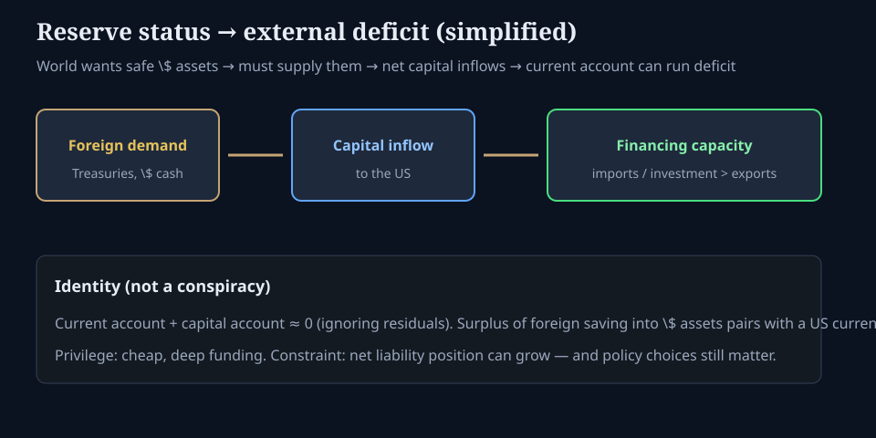

# Reserve currency and the trade deficit

**Deck:** Why the world wanting dollars can show up as a US current-account deficit.  
**Desk:** Macro / global flows  
**Level:** Intermediate

---

## Why this is not a gotcha

People often treat “reserve currency” as pure privilege and “trade deficit” as pure failure. On a desk, they are often **two sides of the same identity**: if the rest of the world wants to *accumulate* your safe assets, someone in your country is on the other side of that capital flow.

This essay is mechanics, not politics.

---

## The simple chain

1. **Foreigners want \$ assets** — Treasuries, bank deposits, dollar credit claims — because they are liquid, deep, and accepted in crises.  
2. That demand is a **capital inflow** into the United States (foreigners buy US claims).  
3. In balance-of-payments accounting, a persistent capital account surplus is paired with a **current account deficit** (goods, services, income — net).  
4. So “everyone wants our bonds” and “we import more than we export” are not independent mysteries. They are constrained by the same ledger.

You already have a fuller BOP walkthrough in *Global flows and the balance of payments*. This piece is the **reserve-status shortcut**: status → demand for safe assets → room (and pressure) to run an external deficit.

---

## Privilege and constraint in one breath

| Privilege | Constraint |
|-----------|------------|
| Deep funding markets; lower crisis spreads *in \$ terms* for many borrowers | Growing net external liabilities over long horizons |
| Invoicing and commodity trade still lean on dollars | Policy mistakes still matter — status is not infinite insurance |
| Safe-haven bid in stress can *strengthen* the currency | Safe-haven bid can hurt export competitiveness |

None of this says deficits are “good” or “bad.” It says **you cannot analyze the deficit without the capital-account story**, especially for the issuer of the main reserve asset.

---

## What to watch on the terminal (education)

- **Real yield differentials** and global rate gaps (carry and portfolio flows).  
- **Cross-currency basis** — offshore dollar funding stress (see FX / xccy essay).  
- **Treasury supply and foreign holdings** narratives in macro news — as *flow context*, not a trade signal.  
- **DXY-style strength** alongside risk assets: sometimes “\$ up / risk up” is rate differential; sometimes it is pure flight.

---

## Common confusions

- **“Printing caused the deficit.”** Money creation and external balances interact, but the BOP identity is about *who saves and invests where*, not a single money-printer cartoon.  
- **“A deficit means we are broke.”** Reserve issuers can run external deficits for long periods *while remaining the preferred liability*. That is not the same as unlimited fiscal space.  
- **“Strong dollar always kills the story.”** A strong dollar can coexist with reserve demand; it also reshapes corporate earnings and EM stress. Separate the channels.

---

## One-sentence takeaway

**Reserve currency status creates structural demand for your liabilities; that capital inflow is the mirror of a current-account deficit — privilege and constraint in the same identity.**

Educational only. Not investment advice.
