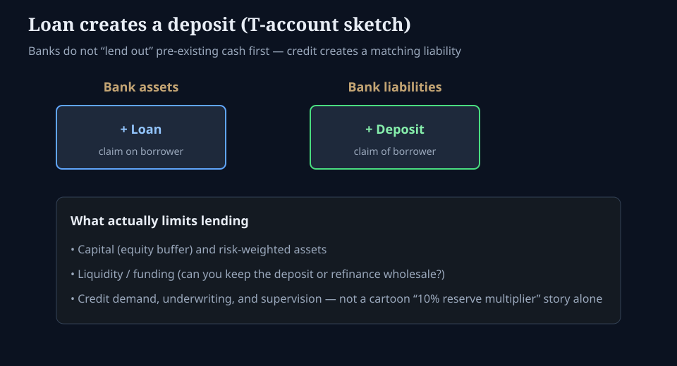

# How banks create deposits (without the myth)

**Deck:** Credit creates money. Capital and liquidity decide how much.  
**Desk:** Macro / money markets  
**Level:** Intermediate

---

## The myth to retire

Pop versions of “fractional reserve banking” say:

1. Someone deposits \$100.  
2. The bank keeps \$10 and “lends out” \$90.  
3. That multiplies until the system is a pure reserve ratio machine.

Modern banking is closer to this:

**When a bank makes a loan, it typically creates a matching deposit liability at the same time.** The balance sheet expands on both sides. Reserves and wholesale funding matter for *settlement and liquidity*, not as a simple piggy bank that was pre-filled with your cash before any loan existed.

---

## T-account, one step

| Assets | Liabilities |
|--------|-------------|
| **+ Loan** (claim on borrower) | **+ Deposit** (claim of borrower) |

The borrower now has a deposit they can spend. When they pay a supplier at *another* bank, reserves or clearing balances move. That is the plumbing — not optional flavor text.

---

## What actually limits lending

| Constraint | Why desks care |
|------------|----------------|
| **Capital** | Equity absorbs losses; risk-weighted assets and leverage ratios cap how big the book can grow |
| **Liquidity / funding** | Can the bank retain deposits, roll wholesale funding, and meet outflows? |
| **Credit demand & underwriting** | No solvent demand → no loan, ratio story or not |
| **Supervision & risk appetite** | Rules and internal limits bind before any textbook multiplier finishes |

If overnight funding is stressed (repo, RRP corridor, basis trade forced de-lever), the *price* of balance-sheet space rises even when “reserves in the system” look large. That is why money-market essays sit next to equity risk on this terminal.

---

## Debt-based system without the conspiracy tone

Households, firms, and governments carry debt claims. Banks and markets intermediate them. Saying “the system runs on debt” is an accounting observation: **financial assets are someone else’s liabilities.**

Useful desk questions:

- Whose balance sheet is expanding (banks, funds, fiscal)?  
- Is expansion **funded** stably or rolled short?  
- Where does stress show first — funding spreads, basis, FX dollar shortage, credit spreads?

---

## Link to other Academy lessons

- *Where cash actually sleeps overnight* — corridor, RRP, SOFR.  
- *Repo hierarchy* — who funds whom when deposits leave.  
- *Treasury basis* — leverage on top of bank and dealer balance sheets.

---

## One-sentence takeaway

**Banks create deposits when they create loans; capital, liquidity, and credit reality — not a cartoon reserve multiplier — set the limit.**

Educational only. Not investment advice.
