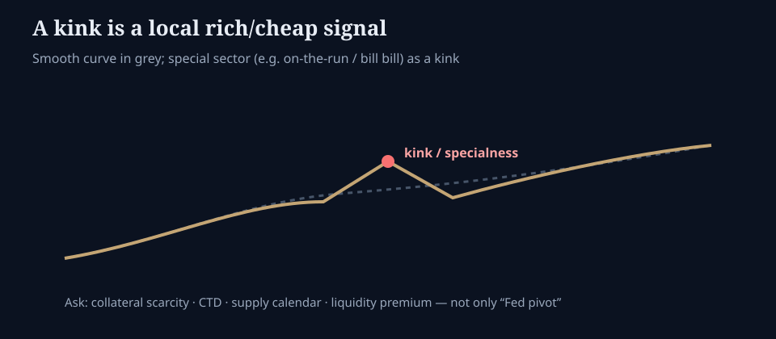

# Kinks on the yield curve

**Deck:** A smooth curve is a model. A kink is often a market.  
**Desk:** Rates / relative value  
**Level:** Intermediate+

---

## Smooth is the exception

Fitted yield curves (splines, NSS, desk spreadsheets) look elegant. Cash bonds and bills do not always sit on them. **A kink** is a local region where a maturity, coupon, or issue looks rich or cheap versus neighbors for a *reason* — not random noise.

If you only read “the 10s” from a continuous model, you will miss **specialness**.

---

## What creates kinks (checklist)

| Driver | Mechanism |
|--------|-----------|
| **On-the-run / off-the-run** | Newest issue often more liquid; repo specialness can pull yields |
| **CTD / futures delivery** | Cheapest-to-deliver dynamics bend cash vs futures relationships |
| **Supply calendar** | Auction weeks, buybacks, large maturities change free float |
| **Collateral demand** | Specific CUSIPs wanted in repo → lower yields (price up) |
| **Regulatory / index effects** | Preferred habitat demand from funds, banks, insurers |
| **Credit / structure** | For non-Treasury curves: coupon effects, callables, ASW packaging |

RV desks live here. Equity people should still care: **kinks flag where leverage and funding are concentrated.**

---

## How to read a kink without overtrading it

1. **Is it liquidity or value?** Wide bid-ask and tiny free float are not free alpha.  
2. **Is repo special?** A bond that is hard to borrow can look “rich” on a cash curve while financing is the real story.  
3. **Does the fly / butterfly agree?** Neighbor wings should tell you if the belly is the outlier.  
4. **Does futures basis agree?** Cash kink vs CTD stack — see *Treasury basis* essay.  
5. **Is the story calendar-bound?** Auction week distortions often mean-revert; structural collateral demand may not.

---

## Link to other lessons

- *Relative value on the curve* — butterflies and PCA language.  
- *Treasury basis* — when cash–futures is the trade, not the cash kink alone.  
- *Swaps, spreads, and convexity* — when the “curve” is swaps, not Treasuries.

---

## One-sentence takeaway

**A kink is information about liquidity, collateral, or supply — treat it as a funding story first, a “Fed call” second.**

Educational only. Not investment advice.
