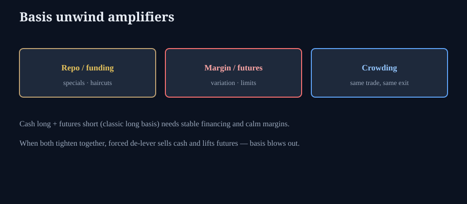

# Basis trade blowup modes

**Deck:** Companion to the calm basis essay — what actually forces the unwind.  
**Desk:** Macro / rates leverage  
**Level:** Intermediate+

---

## Read this after

*The Treasury basis trade, explained calmly* covers definitions, carry, and CTD. This note is only the **failure modes** — how a crowded, levered cash–futures book becomes a systemic seller.

---

## Mode 1 — Funding / repo

- Specials, haircuts, or balance-sheet scarcity raise the cost of financing the cash leg.  
- Carry that looked positive turns negative.  
- Positions that “always rolled” stop rolling.

## Mode 2 — Futures margin and variation

- Volatile bond futures drain cash via variation margin.  
- Limits and liquidity on the futures side can force size cuts even if “the basis thesis” is intact.  
- Cash and futures no longer move as a clean hedge in a squeeze.

## Mode 3 — Crowding and correlation of exits

- Many accounts run similar long-cash / short-futures (or the reverse) books.  
- One fund’s de-lever is another’s mark-to-market shock.  
- Dealers pull risk; spreads gap; the “arbitrage” is no longer self-financing.

## Mode 4 — Policy and liquidity regime shift

- QT, SLR, RRP dynamics, or sudden safe-asset demand change free float and financing.  
- The corridor essays (*RRP / SOFR*) are the oxygen for this trade.

---

## What equity desks should hear

You do not need a basis book. You need to know that **forced Treasury de-lever can reprice risk assets and the dollar** through funding, not through a single earnings headline.

Pair with *Crisis transmission template* and *Diversification under stress*.

---

## One-sentence takeaway

**Basis blowups are funding + margin + crowding events — the math of fair value is secondary once cash is scarce.**

Educational only. Not investment advice.
