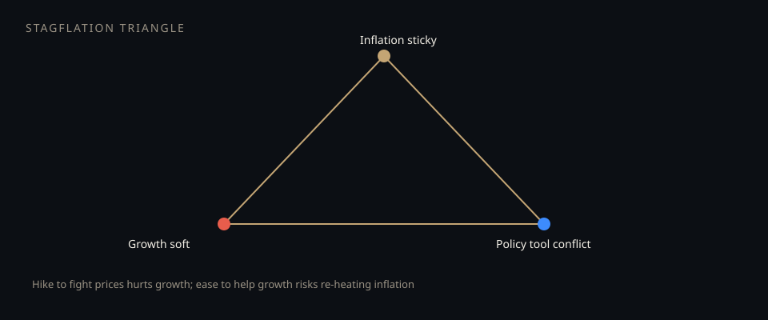

# Stagflation risk and policy limits

**Deck:** Soft growth + sticky inflation puts the policy tool in conflict. Markets price that conflict in real yields, curves, and risk premia — not in slogans about “the Fed will save us.”  
**Desk:** Macro  
**Level:** Intermediate

---

## The conflict in one picture

- **Inflation sticky** → needs tighter policy (or at least restrictive financial conditions).  
- **Growth soft** → wants easier policy / more liquidity.  
- **One main short-rate tool** cannot maximize both at once.

That is the stagflation **policy triangle**. Fiscal, supply shocks, and labor market structure can make the corners worse.

---

## What “the Fed won’t save risk assets” actually means

Not a prediction. A **mapping**:

| If policy prioritizes… | Typical market bias (not a law) |
|------------------------|----------------------------------|
| **Killing inflation** | Higher real yields, firmer USD, tougher multiples |
| **Cushioning growth** | Easier financial conditions — but inflation re-heat risk if supply is the problem |
| **Stop-go / data dependence** | Higher vol of vol on every print |

“Save us” stories assume a **put under equities** that appears whenever growth wobbles. That put is weaker when inflation is the binding constraint.

---

## Desk read-through

1. **G/I/L** — which leg is binding this month?  
2. **Real yields and 2s10s** — path of restriction vs recession insurance.  
3. **Credit and equity beta** — are they pricing growth fear or inflation fear?  
4. **Vol** — is the surface pricing a growth crash (put skew) or policy chop (event peaks)?

---

## Related Academy

- *Growth, inflation, liquidity*  
- *Inflation prints as a tape driver*  
- *Relative value on the curve*  
- *Quiet VIX through data and the Fed*

---

## One-sentence takeaway

**Stagflation pressure is a policy-tool conflict: measure which constraint binds before you assume a market put.**

Educational only. Not investment advice.
