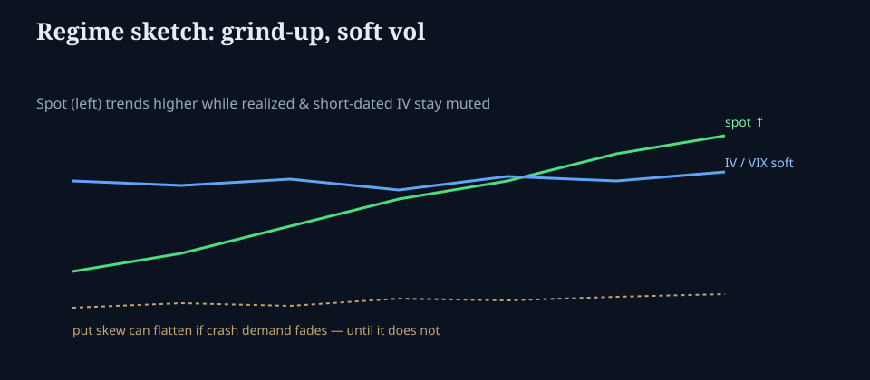

# When vol and skew underperform the tape

**Deck:** Spot grinds up, realized stays calm, short-dated IV and put skew look “too quiet.” That is a regime — until it is not.  
**Desk:** Markets / vol  
**Level:** Intermediate

---

## The pattern desks complain about

Classic tape:

- Equities trend higher (or chop with upside bias).  
- Realized volatility prints soft.  
- Implied vol (VIX-style, short-dated SPX/SPY) fails to “wake up.”  
- Put skew flattens or fails to reprice crash risk the way fear narratives expected.

People say vol is “underperforming.” Translate: **long vol / long skew positions are losing carry while spot path is friendly to short vol.**

---

## Why it can happen (mechanics, not vibes)

| Channel | What it does |
|---------|----------------|
| **Low realized** | Variance swaps and short-dated options earn the VRP for shorts; longs bleed |
| **Systematic supply** | Overwriters, call-overwriting mandates, structured product flows |
| **Dealer / positioning** | In some regimes, dealer gamma and charm stabilize path (see options bridge essay + POS desk) |
| **Complacency is a label** | Often it is *priced* calm after a vol crush — not “wrong until proven” |
| **Skew demand fades** | If crash hedges were crowded earlier, put wing can cheapen as hedges roll off |

None of these guarantee the regime continues. They explain **P&L of vol/skew books while the index looks fine.**

---

## How to read it without becoming a tip account

1. **Separate IV level, term structure, and skew.** Soft VIX + steep front event peak is a different animal from flat everything.  
2. **Compare IV to recent realized** (VRP essay) — not to Twitter fear.  
3. **Ask what broke last time:** funding, growth scare, policy shock, single-name contagion. Soft vol does not cancel those channels; it prices them cheaply.  
4. **Use the Vol desk** for surface and term; Academy is the language, tools are the measurement.

---

## Related Academy

- *Variance risk premium*  
- *Reading the vol surface*  
- *Why equity books still care about options* (dealer path)  
- *What options are saying about equities* (markets track)

---

## One-sentence takeaway

**“Vol underperformance” is usually friendly spot path + soft realized + supply of short vol — a regime you measure on the surface, not a moral failure of the VIX.**

Educational only. Not investment advice.
