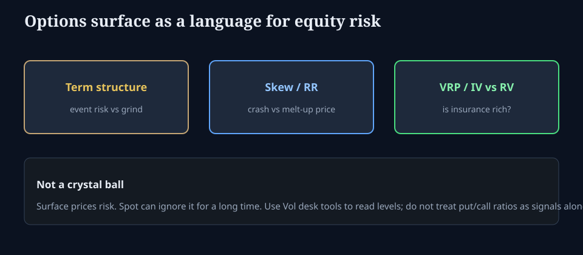

# What the options market is saying about equities

**Deck:** The surface is a language for risk — not a prophecy of the next close.  
**Desk:** Markets / equities × vol  
**Level:** Intermediate

---

## Why equity people should open the surface

Cash equities show **where** price is. Options show **what risks are expensive to insure** along strike and maturity. You do not need to trade options to read that language. You do need to avoid treating a single put/call ratio tweet as “the market’s view.”

---

## Three readouts that matter

### 1. Term structure

| Shape | Rough reading (education) |
|-------|---------------------------|
| Front elevated vs back | Near-term event or fragile path |
| Back elevated / contango | Carry of vol; grind risk priced later |
| Inverted hard | Stress or known binary (FOMC, CPI, earnings cluster) |

### 2. Skew / risk reversal

| Shape | Rough reading |
|-------|----------------|
| Steep put wing | Crash insurance demand / downside jump fear |
| Flatter skew in a rally | Crash demand faded *or* supply of puts — confirm with flow context |
| Call wing bid | Melt-up / squeeze / single-name call culture (more names than SPX) |

### 3. IV vs realized (VRP)

Insurance can be rich while the index rises for months. That is consistent, not a paradox — **you are looking at two different objects** (path so far vs priced future variance).

---

## What options do *not* say cleanly

- Exact top/bottom of SPX next week.  
- That “smart money” is always long the wing that is expensive (expensive can mean *demand* or *dealer inventory*).  
- That zero open interest in a strike means “no risk there.”

---

## Practical loop with this terminal

1. Open **Vol** desk: surface, smile, term.  
2. Note level + skew + term in one sentence (“front soft, 25d put still bid, back quiet”).  
3. Cross-check **Macro** funding (if dollar basis or SOFR is screaming, soft equity vol is a fragile combo).  
4. If you care about *who must hedge*, open **Positioning** — not for a tip, for the path bias tools.

---

## One-sentence takeaway

**Options price the cost of risk along strike and time; use that language to frame equity risk — never as a standalone crystal ball.**

Educational only. Not investment advice.
