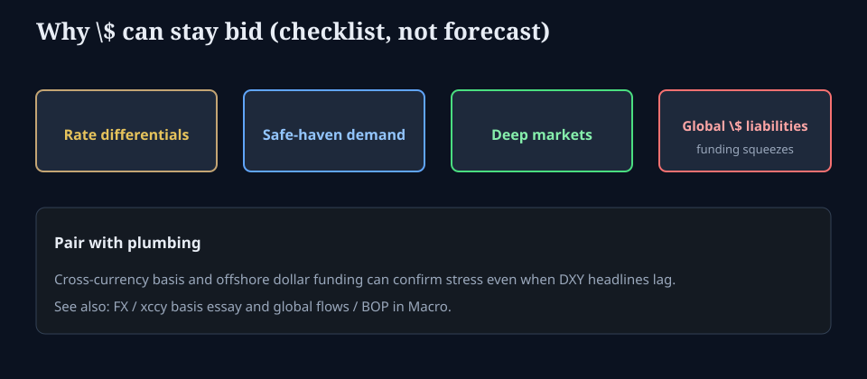

# Why the dollar can stay strong

**Deck:** Rate gaps, safe-haven demand, deep markets, and global dollar liabilities — a checklist, not a call.  
**Desk:** Markets / FX  
**Level:** Intermediate

---

## The trap

Narratives rotate: “deficits kill the dollar,” “de-dollarization is inevitable,” “the dollar must collapse under debt.” Sometimes those themes matter. Often the **near-term bid** is simpler: **relative rates, relative safety, and dollar funding plumbing.**

---

## Driver checklist

| Driver | Mechanism |
|--------|-----------|
| **Rate differentials** | Higher real/nominal yields attract portfolio flows into \$ assets |
| **Growth differentials** | Stronger US growth narrative supports equity inflows and \$ |
| **Safe-haven / risk-off** | In stress, demand for liquid \$ cash and Treasuries can rise even if “the problem started in the US” |
| **Market depth** | Treasuries and \$ funding markets remain the default scale venue |
| **Global \$ liabilities** | Non-US borrowers need dollars; squeezes bid the currency and widen basis |
| **Terms of trade / energy** | Commodity and invoice currency effects (context-dependent) |

Privilege of reserve status (see *Reserve currency and the trade deficit*) **interacts** with these drivers; it does not replace them day to day.

---

## Plumbing confirmation

When the dollar is “strong” in headlines, ask:

1. Is **cross-currency basis** showing dollar scarcity offshore?  
2. Are **EM and G10 high-beta FX** the release valve?  
3. Is strength **rate-driven** (yield gap) or **stress-driven** (flight)?  
4. Do US assets rise *with* the dollar (risk-on + US exceptionalism) or fall (classic risk-off)?

The Macro track’s FX / xccy and global flows essays are the deep dive; this Markets note is the **cross-asset dashboard framing**.

---

## What “strong dollar” does to other desks

- **Equities:** translation, multinationals, EM beta.  
- **Vol:** sometimes soft domestic vol with noisy global vol — regime dependent.  
- **Rates:** foreign demand for Treasuries vs local supply story.

---

## One-sentence takeaway

**A firm dollar is often rates + safety + funding demand — measure differentials and basis before you write a collapse essay.**

Educational only. Not investment advice.
