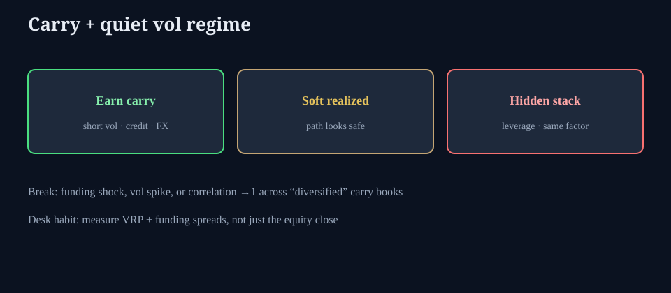

# Carry regimes and quiet vol

**Deck:** When calm path pays short-vol and carry books — and what usually ends the party.  
**Desk:** Markets / cross-asset  
**Level:** Intermediate

---

## What “keep calm and carry on” means on a desk

In friendly regimes:

- Realized volatility is soft.  
- Credit and FX carry print.  
- Overwriting and short-dated vol selling feel like income.  
- Correlation between “diversified” risk premia stays moderate.

The equity close can look fine while **the real P&L engine is carry + short vol**. That is not free money; it is compensation for left-tail and funding risk that is not firing *this week*.

---

## The stack under the calm

| Layer | What is going on |
|-------|------------------|
| **Path** | Spot grinds or mean-reverts gently |
| **Vol** | IV and realized both soft; VRP often paid to shorts |
| **Leverage** | Same strategies scale up because drawdowns look small |
| **Funding** | Repo / dollar markets quiet enough to finance the stack |
| **Correlation** | Factors look independent until they share a forced exit |

See also *When vol and skew underperform the tape* and *Variance risk premium*.

---

## How carry regimes break (checklist)

1. **Vol spike** — short gamma / short vol books lose faster than carry earned year-to-date.  
2. **Funding shock** — haircuts, specials, basis stress, dollar scarcity offshore.  
3. **Credit event** — HY and equity beta re-link; “uncorrelated” income trades gap.  
4. **Crowded unwind** — everyone long the same calm; liquidity vanishes on the exit.  
5. **Policy / geopolitical binary** — term structure re-prices front vol first.

You do not need to predict which one. You need to know **which books are on the same side of calm**.

---

## Terminal loop

1. **Vol desk:** IV vs recent realized, term, skew.  
2. **Macro / rates:** SOFR corridor, basis, xccy if global.  
3. **Markets essays:** dollar strength + options language.  
4. **Positioning:** if index path is being stabilized or accelerated by options inventory.

---

## One-sentence takeaway

**Quiet vol is often a carry regime with leverage underneath — measure funding and VRP, not only the index print.**

Educational only. Not investment advice.
