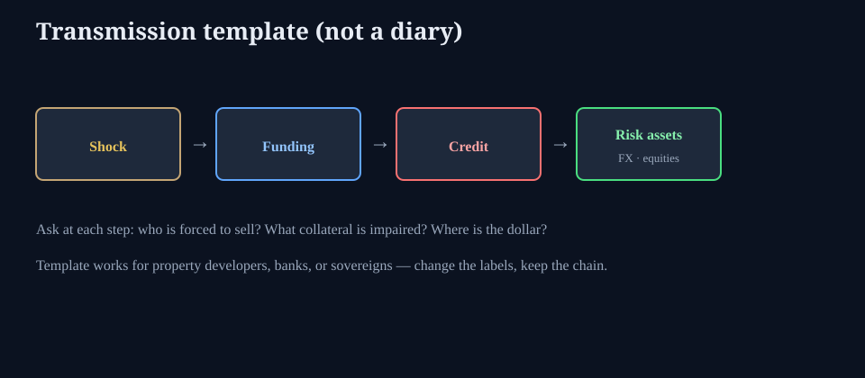

# Crisis transmission (template, not a diary)

**Deck:** Shock → funding → credit → risk assets. Change the labels; keep the chain.  
**Desk:** Markets / macro  
**Level:** Intermediate

---

## Why a template beats a timeline

Named crises (developers, regional banks, sovereigns) differ in cast. Transmission is repetitive:

1. A **shock** hits collateral, cash flow, or confidence.  
2. **Funding** markets reprice access to cash (repo, commercial paper, FX swaps).  
3. **Credit** spreads and roll risk widen; forced sellers appear.  
4. **Risk assets** and FX absorb the spillover — sometimes with a lag, sometimes instantly.

Academy does not need another 2021 news recap. It needs a **checklist you can run on any headline week**.

---

## Stage questions

| Stage | Ask |
|-------|-----|
| **Shock** | Whose cash flow or asset value just broke? Is it local or systemic collateral? |
| **Funding** | Who cannot roll overnight? Is dollar funding scarce (basis / xccy)? |
| **Credit** | Which bonds or loans cannot refinance? Who marks the book? |
| **Risk assets** | Who is forced to sell equities/FX for margin or redemptions? |
| **Policy** | Which facility or backstop can slow the cascade — and with what lag? |

---

## Cross-links on this terminal

- *Repo hierarchy* / *RRP corridor* — funding layer.  
- *Treasury basis* / *Basis blowup modes* — leverage amplifier.  
- *Strong dollar* / *FX basis* — global dollar channel.  
- *Diversification under stress* — correlation collapse of “hedges.”

---

## How to use it without becoming a doomer

- Run the chain **even in calm** once a month so the questions are muscle memory.  
- Prefer **plumbing metrics** over narrative adjectives.  
- If funding is fine and only equity narrative is loud, weight the cascade lower.  
- If funding is stressed and equities are calm, do not assume equities “know better” forever.

---

## One-sentence takeaway

**Every crisis story is a transmission story — map shock to funding to credit to risk assets before you invent a unique theory.**

Educational only. Not investment advice.
