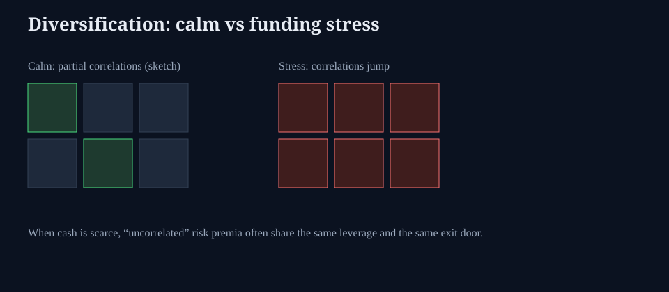

# Diversification under funding stress

**Deck:** In calm, correlations look partial. When cash is scarce, exits synchronize.  
**Desk:** Markets / portfolio risk  
**Level:** Intermediate

---

## The calm story

Textbook diversification: hold assets with low correlation so portfolio variance falls. In good times you often observe:

- Equities vs bonds sometimes hedge.  
- Regions and sectors rotate.  
- Carry strategies look independent of beta.

That sample is **conditional on easy funding and orderly markets**.

---

## The stress story

Under funding stress:

- **Margin and redemption** turn many “independent” books into the same seller.  
- **Safe** assets can sell off if they are the only liquid collateral.  
- FX and equities can gap together when dollar liquidity is the scarce good.  
- Vol spikes across underlyings; short-vol overlays fail at once.

Diversification did not “stop working” as math. The **economic factor** (liquidity / leverage) that was quiet became common.

---

## Practical desk rules (education)

| Habit | Why |
|-------|-----|
| Stress correlation, not only historical | Sample calm understates co-movement in crises |
| Map shared leverage | Same prime broker, same repo, same ETF channel |
| Separate economic hedges from trading hedges | Long duration may hedge growth *and* lose in inflation-funding hybrids |
| Watch liquidity hierarchy | What still trades when everyone exits? |
| Pair with funding essays | Diversification fails where money-market essays start |

---

## What this is not

- Not a claim that you should hold one asset only.  
- Not a product pitch for any “crisis-proof” fund.  
- Not a substitute for position sizing and liquidity planning.

---

## One-sentence takeaway

**Diversification is a funding-regime statement — when cash is scarce, many risk premia share one exit door.**

Educational only. Not investment advice.
