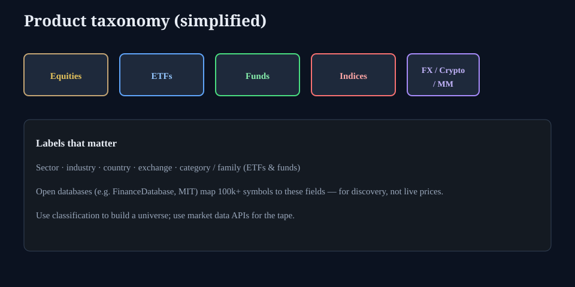

# How the investable universe is labeled

**Deck:** Classification databases map symbols to product, sector, country — for discovery, not prices.  
**Desk:** Markets / universe construction  
**Level:** Start here / intermediate

---

## The problem

There are hundreds of thousands of listed equities, ETFs, funds, indices, FX pairs, crypto tickers, and money-market references. Tips culture names five tickers. Desk work starts with **what exists in a category**.

Open projects such as [FinanceDatabase](https://github.com/JerBouma/FinanceDatabase) (MIT) publish large symbol catalogs with sector, industry, country, exchange, and ETF/fund family labels. They explicitly **do not** replace live market data: use them to **find and filter**, then pull prices from your market APIs (as this terminal already does elsewhere).

---

## Product buckets (simplified)

| Product | What you are looking at |
|---------|-------------------------|
| **Equity** | Single-name shares |
| **ETF** | Listed fund; category/family matter as much as ticker |
| **Fund** | Often mutual/collective vehicles with category labels |
| **Index** | Benchmark, not always tradeable 1:1 |
| **Currency** | FX pairs |
| **Cryptocurrency** | Digital assets |
| **Money market / rates refs** | Benchmarks and cash-like instruments |

---

## Sample slice (educational)

A small curated extract lives at:

`/docs/academy/data/universe-sample.csv`

It is **not** the full FinanceDatabase. It is a teaching table of familiar sleeves (beta, duration, credit, dollar, cash-like) in the same *kind* of columns: symbol, product, category, geography.

| symbol | product | category (illustrative) |
|--------|---------|-------------------------|
| SPY | ETF | US large-cap blend |
| TLT | ETF | Long government |
| HYG | ETF | High yield |
| EURUSD | Currency | G10 FX |
| SOFR | Money market ref | USD overnight |

Open the CSV for the full mini set. In production research you would filter the full database (or a vendor) the same way.

---

## How to use this with VOLATERM

1. **Define the universe** with labels (e.g. “US HY credit ETFs,” “G10 FX,” “energy equities”).  
2. **Load market data** for the shortlist on Vol / rates / crypto desks.  
3. **Do not** expect a classification CSV to give you SOFR history or option surfaces — those are separate pipelines.  
4. Later product work can wire a full FinanceDatabase extract into search; Academy only teaches the *idea*.

---

## One-sentence takeaway

**Classification maps tell you what exists; market data tells you what it costs — keep the jobs separate.**

Educational only. Not investment advice. FinanceDatabase is an independent MIT-licensed project; we use the idea and a tiny educational sample, not a full redistributed dump.
