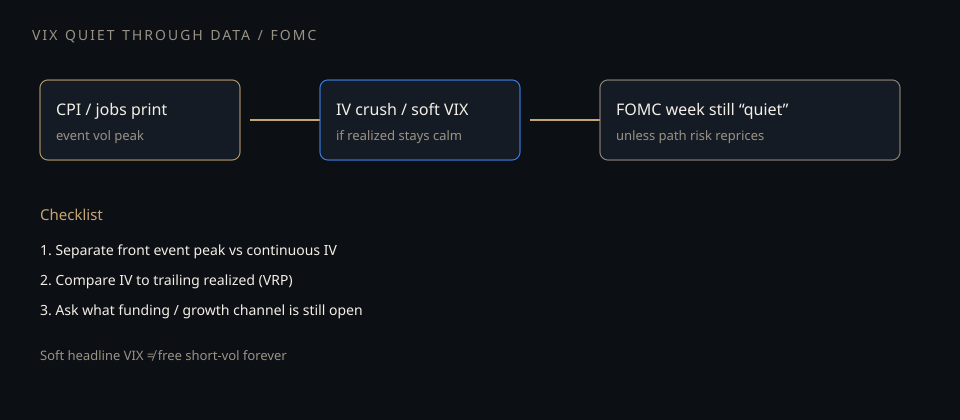

# Quiet VIX through data and the Fed

**Deck:** Headline vol can stay soft into CPI and FOMC week. That is a surface shape problem, not proof that risk is free.  
**Desk:** Markets / vol  
**Level:** Intermediate

---

## What “VIX underperforming” usually means

People watch a print or a Fed meeting, expect the fear gauge to jump, and it does not. Translate carefully:

- **Front event peak** may still be rich relative to quiet days.  
- **Continuous / mid-curve IV** can stay soft if realized path stays calm.  
- **Headline VIX** is a 30-day SPX-ish basket — not a pure “today’s CPI” instrument.

So the complaint is often: **spot path and realized did not validate long vol**, while the calendar looked scary on paper.

---

## Three channels that keep IV soft into loud weeks

| Channel | Mechanism |
|---------|-----------|
| **Crush after the number** | Market prices a peak into the print; after a “good enough” print, front IV dies |
| **Supply of short vol** | Overwriting, structured products, systematic short-vol programs |
| **Policy scripted range** | If the Fed path is already in the curve, FOMC can be noise until a surprise |

None of these cancel gap risk. They explain **why long vol can lose while the diary looks eventful.**

---

## Desk checklist (measure, don’t narrate)

1. Split **event-dated** vol from **steady-state** IV.  
2. Compare IV to **trailing realized** (see VRP essay).  
3. Watch **rates path** the same morning — inflation and Fed are rates stories first.  
4. Use Vol desk surfaces; use Academy for language.

---

## Related Academy

- *When vol and skew underperform the tape*  
- *The variance risk premium*  
- *Inflation prints as a tape driver*  
- *Reading the vol surface*

---

## One-sentence takeaway

**A quiet VIX into data or FOMC is often event pricing + soft realized + short-vol supply — measure the surface, do not outsource risk to the headline gauge.**

Educational only. Not investment advice.
