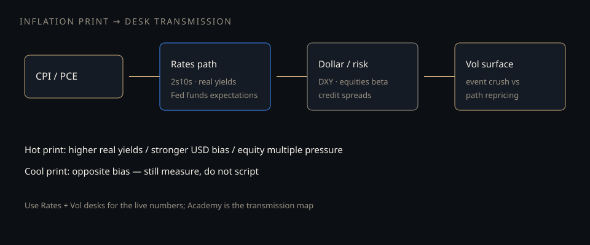

# Inflation prints as a tape driver

**Deck:** CPI/PCE days reprice rates, the dollar, risk premia, and the vol surface in one morning. Map the transmission — do not memorize slogans.  
**Desk:** Markets / macro link  
**Level:** Intermediate

---

## Why inflation still moves the tape

Inflation prints update the **policy reaction function** the market has priced:

- Higher sticky inflation → higher expected policy rates / higher real yields bias.  
- That hits **discount rates** for equities, **USD** via rate differentials, and **credit** via growth vs policy tradeoff.  
- Options reprice **event vol** into the print and **path vol** after the path of rates shifts.

This is why “is inflation important?” is not a 2021-only question. Any regime where the Fed is data-dependent, the print is a **risk window**.

---

## Transmission map (desk order)

1. **Print vs consensus vs prior revisions** — the surprise, not the level alone.  
2. **Rates desk** — 2s, 10s, real yields, front SOFR/fed funds path.  
3. **Dollar and beta risk** — strong real-yield surprises often firm USD and pressure long-duration risk.  
4. **Vol surface** — crush if the number lands in the middle of the prior distribution; **path reprice** if the policy path moves.

---

## What not to do

- Treat one CPI as a full macro regime change without the rates path.  
- Confuse **headline** with **core / services** when the market is trading the latter.  
- Trade “hot = always sell stocks” as a law — transmission depends on growth, liquidity, and positioning.

---

## Related Academy

- *G/I/L in practice*  
- *Quiet VIX through data and the Fed*  
- *Why the dollar can stay strong*  
- *Where cash sleeps overnight* (RRP/SOFR corridor)

---

## One-sentence takeaway

**Inflation prints matter because they reprice the policy path; the tape you feel is rates → FX/risk → vol, not a morality play about the CPI number.**

Educational only. Not investment advice.
