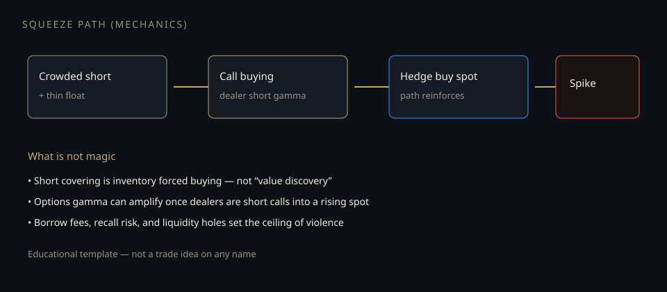

# Squeeze mechanics without the meme

**Deck:** Extreme single-name spikes (think “short interest + call mania” episodes) are inventory and gamma path problems — not proof that social media invents prices.  
**Desk:** Markets / options link  
**Level:** Intermediate

---

## The mechanical stack

A violent upside path often needs several ingredients at once:

| Ingredient | Role |
|------------|------|
| **Crowded short / high borrow** | Forced covering is market buy flow |
| **Thin free float / liquidity holes** | Small flow moves the print |
| **Call buying → dealer short gamma** | Dealers buy spot into strength to re-hedge |
| **Recall / locate stress** | Borrow gets expensive; shorts exit under pressure |

No single ingredient is “the” story. The **interaction** produces the path.

---

## Options without the cosplay

When customers buy calls aggressively:

- Market makers who sell those calls are often **short gamma / short upside delta** as spot rises.  
- Hedging means **buying the underlying** into the move — a feedback loop.  
- That is the same family of dealer-path ideas as index GEX language, at single-name scale and with worse liquidity.

Academy teaches the **map**. Live GEX / walls live on the **Positioning desk**, not as a homework formula here.

---

## What desks actually write down

1. Short interest + days-to-cover style inventory risk.  
2. Options OI by strike (call walls vs put support — rough language).  
3. Borrow fee / availability if you can see it.  
4. Whether the move is **flow path** or **fundamental reprice** (usually both claim credit after the fact).

---

## Related Academy

- *Why equity books still care about options*  
- *Gamma, vanna, charm on the underlying*  
- *Crisis transmission template*  
- Positioning desk for live charts

---

## One-sentence takeaway

**Squeezes are forced inventory + gamma feedback in thin liquidity — study the mechanics, ignore the costume drama.**

Educational only. Not investment advice. Not about any specific ticker.
