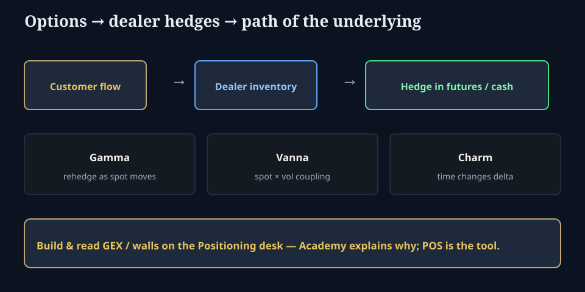

# Why equity books still care about options

**Deck:** Customer options flow becomes dealer inventory; gamma, vanna, and charm change how hedges hit the underlying.  
**Desk:** Options → Positioning  
**Level:** Intermediate

---

## The one-liner for equity PMs

**You may not trade options. Options still trade your index.**

Index options notionals are large. When customers buy or sell, dealers (and other intermediaries) often end up with the **other side**. To stay closer to risk limits, they **hedge with futures or cash**. Those hedges are a path channel for the underlying — especially around large strikes, expiries, and vol shocks.

---

## Three greeks that change the path story

| Greek | Plain English | Path intuition |
|-------|----------------|----------------|
| **Gamma** | How delta changes as spot moves | Dealers short gamma may sell into weakness / buy into strength (accelerant); long gamma the opposite (stabilizer) — *depends on net inventory* |
| **Vanna** | Spot–vol coupling of delta | Vol shocks reprice delta; hedges adjust even if spot is quiet |
| **Charm** | Delta decay with time | As expiry approaches, delta profiles shift; re-hedges can cluster near the clock |

Skew and surface shape (other Academy essays) change *how expensive* the wings are; **positioning** changes *who is forced to trade the underlying*.

---

## What “GEX” is (concept, not a homework calculator)

**Gamma exposure (GEX)** style metrics try to summarize, under assumptions, how much dealer hedging might amplify or dampen moves at different spot levels. Related ideas: zero-gamma / flip zones, call walls, put support, HVL-style levels.

**Important product rule on this terminal:**

- **Academy** teaches *why the channel exists*.  
- **Positioning desk** is where you **build and read** GEX-style tools, walls, and session grammar.

We deliberately do **not** paste a full “implement GEX in twelve steps” lab here. That belongs next to live chain and book tools, not as a static essay that goes stale.

---

## How to use this without cargo-culting

1. Read surface language on **Vol** (is crash insurance rich?).  
2. Open **Positioning** for dealer-mode / level tools on your symbol.  
3. Ask: *if spot moves 1%, who is forced to trade, and in which direction under our model assumptions?*  
4. Treat every model as **assumption-sensitive** (what is “dealer” long/short, multiplier, OI quality).

---

## Related reading

- *Vanna, volga, and skew*  
- *Greeks hierarchy*  
- *Taylor P&L*  
- Positioning desk tools (product, not Academy track)

---

## One-sentence takeaway

**Options inventory forces hedges; hedges move underlyings — learn the channel here, measure it on the Positioning desk.**

Educational only. Not investment advice.
