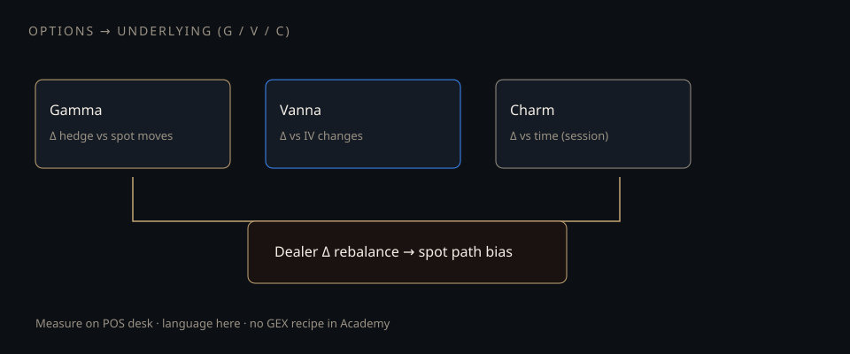

# Gamma, vanna, charm — how options hit the underlying

**Deck:** Dealer hedges turn options inventory into spot path. Gamma, vanna, and charm are three different reasons the hedge size changes.  
**Desk:** Options → equity path  
**Level:** Intermediate

---

## Three reasons hedges move

Assume dealers are short customer options (common when customers buy protection or upside). Rough intuition — **sign conventions vary by desk**:

| Greek | What changes the hedge | Spot path bias (illustrative) |
|-------|------------------------|-------------------------------|
| **Gamma** | Spot moves | Short gamma: buy high / sell low (amplify); long gamma: opposite (dampen) |
| **Vanna** | Implied vol moves | Vol crush can force delta rebalance even if spot is flat |
| **Charm** | Time passes (session / weekend) | Delta drifts with calendar; hedges rebalance into the clock |

That is the bridge from “options greeks” to “why the index or single name prints the way it does today.”

---

## What equity investors should care about

You do not need to run a market-making book to care:

- **Pin / magnet language** near large OI strikes is often gamma + charm talk.  
- **Vol crush days** are vanna-heavy rebalance days.  
- **0DTE** compresses gamma/charm into a few hours (see 0DTE essay).

Live GEX walls and session charts belong on the **Positioning desk**. Academy is the grammar.

---

## Related Academy

- *Why equity books still care about options*  
- *What 0DTE actually changes*  
- *Why the skew exists (vanna and volga)*  
- *Squeeze mechanics without the meme*

---

## One-sentence takeaway

**Gamma, vanna, and charm are three clocks that force dealer delta — and forced delta is spot flow.**

Educational only. Not investment advice.
