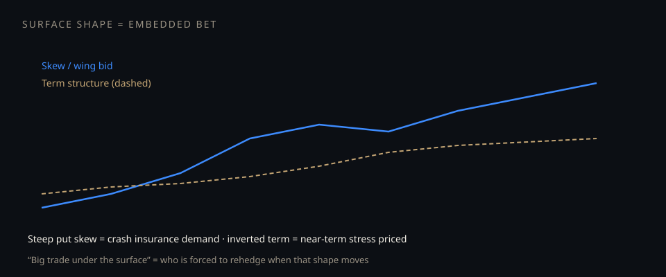

# Big trades under the surface

**Deck:** The vol surface is not decoration. Skew, term structure, and wings are the market’s embedded bets — and the rehedge when those bets move.  
**Desk:** Options / markets link  
**Level:** Intermediate

---

## What “under the surface” means

Spot is the public scoreboard. The **surface** (IV by strike and expiry) is where insurance and leverage are priced:

- **Put skew steep** → crash insurance demand (or dealer/supply imbalance).  
- **Call wing bid** → upside chase or structured flow.  
- **Term inverted** → near-term stress priced richer than the back.  
- **Surface shape change day-over-day** → someone is paying to move the map (see surface shape practice essay).

A “big trade under the surface” is often **not** a single block you can name — it is **positioning that only shows up when the map of IVs shifts.**

---

## How to read without inventing a conspiracy

1. **Level vs shape** — is all IV up, or only the wing / only the front?  
2. **Event vs continuous** — is the bump dated to CPI/FOMC/earnings?  
3. **Who is forced next** — if that shape mean-reverts or extends, whose hedges fire? (GVC essay + POS desk)  
4. **Cross-check equities narrative** — surface often leads or contradicts the Twitter story; measure both.

---

## Related Academy

- *Reading the vol surface like a map*  
- *When the SPY surface shape changes*  
- *What the options market is saying about equities*  
- *Gamma, vanna, charm on the underlying*

---

## One-sentence takeaway

**The surface is the book of embedded bets; the “big trade” is what happens when that book is forced to reprice and rehedge.**

Educational only. Not investment advice.
